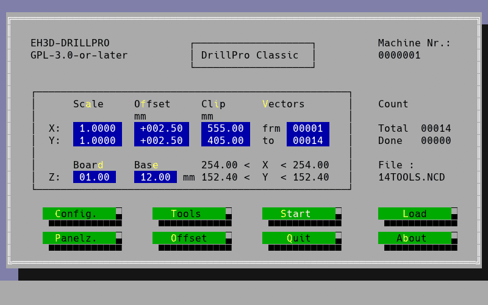
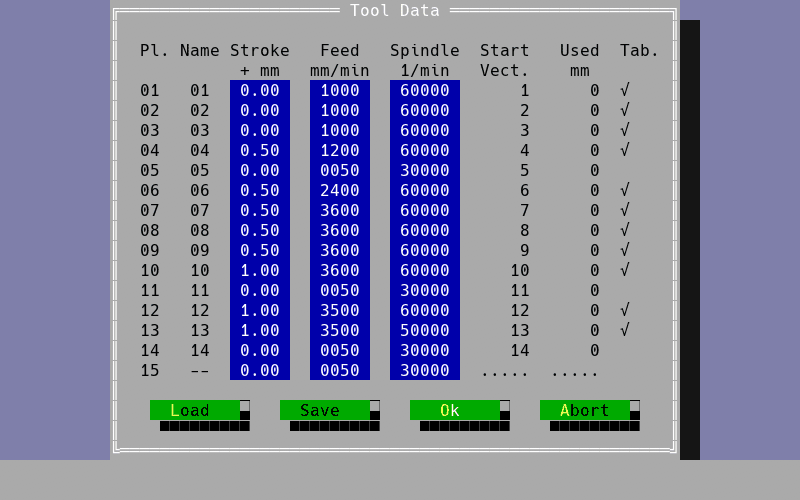
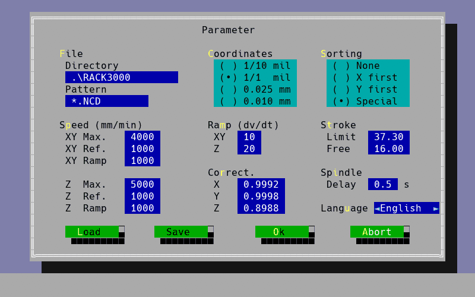
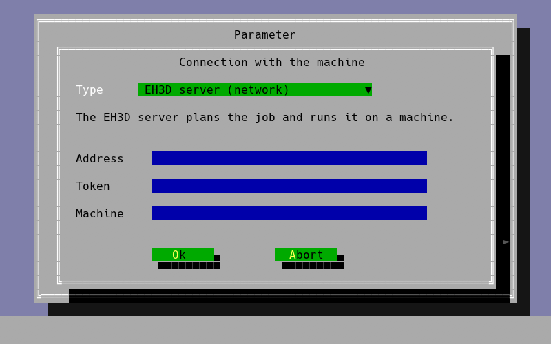

<p align="center">
  
</p>

# 🔩 EH3D-DRILLPRO

<p align="center"><a href="README.md">🇺🇸 English</a> | <a href="README_spa.md">🇪🇸 Español</a> | <a href="README_fra.md">🇫🇷 Français</a> | <a href="README_ita.md">🇮🇹 Italiano</a> | 🇩🇪 <b>Deutsch</b> | <a href="README_zho.md">🇨🇳 中文</a> | <a href="README_jpn.md">🇯🇵 日本語</a> | <a href="README_por.md">🇵🇹 Português</a></p>

### Eine plattformübergreifende Neuimplementierung des Bohr-Ablaufs der klassischen DOS-Software für Bungard-CCD-Maschinen in Rust, mit einer an das Original angelehnten Textmodus-Oberfläche in acht Sprachen

<p align="center">
  
  
  
  
  
</p>

---

**Ehrlichkeitscheck - was heute tatsächlich läuft:** ein Rust-Programm mit einer 80x25-Textoberfläche, das Excellon-Bohrdateien `.NCD`, die Werkzeugtabelle und die Maschinenkonfiguration liest, die Bohrungen ordnet, anzeigt und den ganzen Auftrag entweder **gegen einen Simulator** (Standard) oder, wenn die Maschinendatei es vorgibt, **an einer echten Maschine** über die serielle Schnittstelle des Rechners, einen USB-Seriell-Adapter oder den EH3D-NODE-BUNGARD ausführt. 228 Tests laufen auf einem Rechner. An einer echten Bungard CCD MTC wurden die Referenzfahrt der drei Achsen (Z, X und Y bis zu ihren Endschaltern, mit dem Signal „alle drei in Referenz“ der Steuereinheit live bestätigt) und die Bewegungen jeder Achse erprobt; **ein vollständiger Bohrauftrag lief noch nicht an der Maschine**, und die Schritte pro Millimeter sind nur gegen die Konfiguration des Originals geprüft. Standardmäßig erscheinen die klassischen Bildschirme des MS-DOS-Programms, Zelle für Zelle mit dem Original verglichen; `--modern` startet stattdessen die menügesteuerte Oberfläche. Sie lassen sich mit Tastatur und Maus bedienen, das Fenster kann maximiert werden (der Bildschirm skaliert von 640x400 bis 1080p und mehr), die Konfigurations- und Werkzeugdateien werden in den Dialogen bearbeitet und gespeichert, und die Schaltfläche Info nennt die Bungard-Maschinen CCD und CCD/2 (MTC unterstützt, ATC noch nicht). Eine Konsolenversion (`drillpro-console`) zeigt dieselben Bildschirme im Terminal, mit Tastatur und Maus und ohne Fenstersystem (SSH, Textkonsole, alter PC). Die Pakete jeder Version enthalten die Basiskonfiguration, Zeile für Zeile erklärt, und einen Ordner `examples` von einem Loch bis zu zwanzigtausend. Der Werkzeugwechsler der ATC-Modelle (automatischer Werkzeugwechsel) arbeitet nach einer Aufzeichnung des Originals und lief noch nicht an einer echten Maschine.

---

> **Stand von Sicherheit und IT-Sicherheit:** dieses Programm ist kein Sicherheitssystem. Bei einer echten Verbindung (`connection` in der Maschinendatei) **bewegt Start die Maschine**: Werkzeug herausnehmen, eine Hand am Netzschalter der Maschine halten und `Esc` bereithalten, das den Auftrag sofort stoppt und die Schrittmotortreiber abschaltet. Die Endschalter überwacht die Steuereinheit der Maschine selbst (sie stoppt eine Achse am Schalter von allein); diese Software hat keinen eigenen Not-Aus, und falsche Schrittbytes oder Geschwindigkeiten können das Werkzeug in das Werkstück oder den Tisch fahren oder die Motoren Schritte verlieren lassen. Die Protokollschicht weigert sich, etwas zu bewegen, bevor sie scharf geschaltet wurde. Das Projekt ist unabhängig: Es wird nicht von Bungard Elektronik hergestellt, empfohlen oder unterstützt, und Produktnamen erscheinen nur, um zu sagen, mit welchen Dateiformaten und Maschinen es arbeiten soll.

## 📋 Auf einen Blick

| | |
|---|---|
| Version | `0.0.6` |
| Reifegrad | Gerüst |
| Tests | 228 |
| Technologie-Stack | Rust |
| Auf echter Hardware | Ja, an einer Bungard CCD MTC: die Referenzfahrt und die Bewegungen jeder Achse; ein ganzer Auftrag lief noch nicht. Ohne Maschinendatei läuft es im Simulator |

**Springe zu:** [Überblick](#-überblick) · [Architektur](#-architektur) · [Schnellstart](#-schnellstart) · [Tests](#-tests) · [Struktur](#-struktur-des-repositorys) · [Verwandte](#-verwandte-projekte)

## 🚦 Projektstatus

Jede Zeile ist ein Teil dieses Repositorys, und die Ampel sagt, wie weit er heute ist. Sie beruht auf dem, was das Repository zeigen kann (Tests, Builds, Läufe), nicht auf dem, was geplant ist.

🟢 Fertig und überprüft · 🟡 Funktioniert, mit bekannten Grenzen · 🟠 Teilweise fertig oder noch nicht überprüft · 🔴 Nicht gemacht oder funktioniert nicht

| Bereich | Stand | Was das hier bedeutet |
|---|---|---|
| Software | 🟡 | Ein Rust-Programm mit 80x25-Textbildschirm liest die Bohrdatei, die Werkzeugtabelle und die Maschinendatei, ordnet die Bohrungen und führt den ganzen Auftrag gegen einen Simulator aus, oder auf einer echten Maschine, wenn die Maschinendatei es sagt. |
| Tests | 🟢 | 228 Tests bestehen (`cargo test --workspace`): die Formate, die Auftragsplanung, das Protokoll am Simulator und die Bildschirme in allen acht Sprachen. |
| Dateileser | 🟡 | Die Bohrdatei `.NCD`, die Werkzeugtabelle `DRILLPRO.DTD` und die Maschinendatei `DRILLPRO.DCF` werden gelesen; nur mit kleinen, für die Tests geschriebenen Beispieldateien, nicht mit Dateien echter Platinen. |
| Maschinenprotokoll | 🟠 | Das Byte-Protokoll der Steuereinheit wurde per Reverse Engineering nachgebaut, und `docs/PROTOCOL.md` nennt noch Teile, die Hypothesen sind; die Protokollschicht bewegt nichts, bevor sie scharfgeschaltet wurde. |
| Oberfläche | 🟡 | Der Textbildschirm, die Menüs, der Dateidialog und die Vektoransicht der Bohrungen sprechen alle acht Sprachen (getestet); Chinesisch und Japanisch brauchen eine CJK-Schrift im System. |
| Echte Hardware | 🟠 | An einer Bungard CCD MTC wurden der Referenzlauf der drei Achsen und die Bewegungen jeder Achse erprobt; ein ganzer Bohrauftrag lief nicht, die Schritte pro Millimeter sind nur mit der Konfiguration des Originals abgeglichen, und die Ausgänge für Spindel und Sauger sind unerprobt. |
| Betriebssicherheit | 🟡 | `Esc` stoppt den Auftrag in einem Bruchteil einer Sekunde und schaltet die Schrittmotortreiber ab, und die Steuereinheit der Maschine überwacht die Endschalter; die Software hat keinen eigenen Not-Halt. |
| Serververbindung | 🟠 | Mit `connection = server` schickt das Programm den Auftrag an EH3D-SERVER und verfolgt dessen Fortschritt; dieser Weg wurde nur gegen den Simulator geübt. |
| Fertige Pakete | 🟡 | Die erste Veröffentlichung enthält Pakete für Windows, Linux und macOS (Apple Silicon und Intel), jeweils mit SHA-256, gebaut vom Release-Workflow. |
| Dokumentation | 🟢 | README in acht Sprachen, die Protokollnotizen mit dem, was noch Hypothese ist, und die Anleitung zur Maschinendatei mit jedem Abstimmwert. |

## 🎯 Überblick

* Die **Dateileser**: Excellon-Bohrdateien `.NCD` (mit oder ohne `M48`-Kopf, modale Koordinaten, imperiale Einheiten von 1 mil), die Werkzeugtabelle `DRILLPRO.DTD` und die Maschinenkonfiguration `DRILLPRO.DCF`.
* Der **Auftragsplaner**: ordnet die Bohrungen (wie in der Datei, zuerst X, zuerst Y oder kürzester Weg) und hält sie nach Werkzeug gruppiert.
* Die **Oberfläche**: ein 80x25-Textbildschirm mit CGA-Farben, Menüs, einem Dateidialog und einer Vektoransicht der Bohrungen in einem Fenster. Sie spricht Englisch, Spanisch, Italienisch, Deutsch, Französisch, Portugiesisch, Chinesisch und Japanisch: Die Sprache wählen Sie im Menü oder mit `--lang` beim Start.
* Das **Maschinenprotokoll** (`protocol/`, Crate `eh3d-drillpro-protocol`): eine Bibliothek ohne Oberfläche: Byte-Transport (serielle Schnittstelle oder Simulator), Bewegungsplanung in Millimetern mit Beschleunigungsrampen und eine Sicherheitssperre, die Bewegung verweigert, bis sie scharf geschaltet ist.
* Der **Simulator**: Der ganze Auftrag läuft ohne Hardware bis zum Ende; die Tests verwenden ihn.
* Die **Maschinen**: die mit einer Steuereinheit an der seriellen Schnittstelle, die die DOS-Software 4.6 nutzte: Bungard CCD MTC und CCD/2 MTC (manueller Werkzeugwechsel; die CCD/2 hat den kleineren Tisch von 325 x 270 mm). Tischgröße und die übrigen Maschinenkonstanten stammen aus der Konfigurationsdatei der Maschine. Erprobt wurde nur eine CCD MTC, und die Ausgänge für Bohrspindel und Staubsaugerschaltung sind noch nicht erprobt. Die beiden ATC-Modelle (CCD ATC und CCD/2 ATC, automatischer Werkzeugwechsel) bekommen eigene Anwendungen, gebaut mit dem, was die Rückwärtsanalyse hergibt. Die XL-Modelle und die späteren Maschinen haben eine eigene moderne Steuereinheit und Software und sind nicht abgedeckt.
* Die **Maschinendatei** (`machine.cfg`, von DRILLPRO und ROUTEPRO gemeinsam genutzt): wie der Auftrag zur Maschine gelangt (`demo` Simulator, `rs232` die serielle Schnittstelle des Rechners selbst, `usb` ein USB-Seriell-Adapter oder `node` der EH3D-NODE-BUNGARD über das Netzwerk) und, ein Wert pro Zeile, alles, was an einer echten Maschine abgestimmt wurde: Suchgeschwindigkeiten und Rampen, der Kalibriersprung, die Grenzen der Motoren.
* Die **Referenzfahrt**: Z fährt bis zu seinem Endschalter, dann X und Y, danach ein sanfter Kalibriersprung. Die Steuereinheit meldet „alle drei Achsen in Referenz“ auf der RI-Leitung, die das Programm überwacht; steht die Maschine geparkt, überspringt es die Suchläufe, fährt X und Y 10 mm von ihren Schaltern weg und sucht sie erneut, sodass es ihr Ankommen live sieht.
* **Ruhige Bewegung**: Bewegungen gehen als ein durchgehender Strom hinaus, dessen Bytepositionen die Zeit tragen (ein USB-Adapter liefert die Bytes sonst in Schüben), Z fährt Byte für Byte, und `Esc` bricht einen Auftrag in Sekundenbruchteilen ab und schaltet die Schrittmotortreiber ab.
* Die **Spindel**: standardmäßig die der Steuereinheit selbst (ihre Latch-Bits, bis 60000 U/min); mit `spindle = node` in der Maschinendatei fragt der Auftrag stattdessen beim EH3D-NODE-BUNGARD an (ein Frequenzumrichter an den Ausgängen des Knotens, jede Drehzahl bis zum Maximum des Knotens, bei jedem Stopp angehalten). Mit einem Knoten lesen die Programme außerdem die Lampen der Maschine, sodass jede Achse, die in Referenz kommt, live gesehen wird, ohne die Home-Leitung mitten im Datenstrom zu lesen.
* Die **Serververbindung** (`connection = server` in der Maschinendatei, mit `server_address`, `server_token` und `server_machine`): Statt die Maschine selbst zu steuern, schickt das Programm den Auftrag an den [EH3D-SERVER](https://github.com/JuanenRac/EH3D-SERVER), der ihn mit den Konstanten der Maschine plant, über den Knoten der Maschine ausführt und dem Programm meldet, wie es läuft; das Programm zeigt den Fortschritt und beantwortet die Dialoge wie gewohnt, `Esc` stoppt den Auftrag auf dem Server, und das Schließen des Programms stoppt ihn nicht.
* Die **Auftragsarchive, das Offset-Fenster und die Simulation**: ein Auftrag kann in einem ZIP-Archiv liegen (das Fenster Select File geht hinein, und `drillpro JOB.ZIP` lädt dessen erste Bohrdatei); der Pfeil neben dem Dateinamen listet die Muster `*.NCD`, `*.ZIP` und `*.*`; die Load-Tasten der Werkzeug- und Konfigurationsfenster wählen die zu ladende Datei; an einer echten Maschine fährt das Offset-Fenster sie in die Referenz, folgt jeder Bewegung des Fensters und fährt sie wieder in die Referenz; und der simulierte Auftrag dauert so lange wie auf der Maschine.
* Die **Töne**: `sound_finish` und `sound_tool_change` in der Maschinendatei sind je off (der Standard), `default` (ein Ton des Programms) oder der Pfad einer eigenen WAV-Datei; der erste spielt, wenn ein Auftrag von selbst endet, der zweite, wenn die Maschine ein Werkzeug verlangt.
* **Mehrere Maschinen und Stationen**: mit `connection = server` listet `drillpro --machines` alle Maschinen des Servers, nach Stationen gruppiert, mit dem, was jede tut, ihrem Auftrag und den bereiten Aufträgen (der Server antwortet für alle auf einmal), und `drillpro --machine ID` schickt die Aufträge dieses Programms an diese Maschine statt an die der Maschinendatei; die Maschinen laufen gleichzeitig, ein Auftrag auf jeder.
* **Die im Fenster Konfig. gewählte Verbindung:** eine Auswahlliste mit den fünf Wegen, auf denen der Auftrag die Maschine erreicht (der Simulator, die serielle Schnittstelle, ein USB-Adapter, der EH3D-Knoten und der EH3D-Server), und darunter, was jeder braucht: einen Port, eine Adresse und ein Token, eine Maschine des Servers; das Gewählte wird geprüft, mit OK übernommen und in die Maschinendatei geschrieben, ohne deren übrige Zeilen anzutasten.
* **Ein blinkender Cursor:** der Cursor eines numerischen oder Textfelds, das bearbeitet wird, blinkt (eine halbe Sekunde an, eine halbe Sekunde aus), wie auf den Bildschirmen, denen es folgt.
* **Panels mit Haltestegen und fortsetzbare Aufträge:** ein Panel kann Haltestege außen tragen (wie viele, wie breit, wo), und ein Auftrag kann bereits gebohrte Löcher auslassen, so dass er nach einem Halt weitergeht; das Fenster öffnet sich maximiert.

### 🆚 Das Original und diese Version

Das Original ist das geschlossene MS-DOS-Programm von Bungard, das die CCD-Maschinen steuert. Diese Version ist neu geschrieben, nach Aufzeichnungen dessen, was das Original tut (seine Bildschirme, seine Dateien und was es an die Steuereinheit sendet); Code des Originals ist nicht enthalten. Was gleich ist und was anders:

| Aspekt | Original (MS-DOS) | Diese Version |
|---|---|---|
| Rechner | Nur ein MS-DOS-PC (oder ein Emulator) | Windows, Linux und macOS, 32 und 64 Bit; eine Konsolenversion für SSH und alte PCs |
| Bildschirme | Textmodus 80x25 | Standardmäßig dieselben klassischen Bildschirme, Zelle für Zelle mit dem Original verglichen, mit Maus und einem Fenster, das von 640x400 bis 1080p und mehr skaliert; `--modern` bietet eine menügeführte Oberfläche, EH3D-BUNGARD-GUI eine grafische |
| Sprachen | Die des Programms | Acht: Englisch, Spanisch, Italienisch, Deutsch, Französisch, Portugiesisch, Chinesisch und Japanisch, im Menü oder mit `--lang` umschaltbar |
| Panels | Kopien der Platine auf dem Tisch | Kopien der Platine auf dem Tisch; ein mittendrin unterbrochener Auftrag kann beim nächsten Loch weitergehen |
| Verbindung zur Maschine | Die serielle Schnittstelle des Rechners zur Steuereinheit | Standardmäßig der Simulator; an einer echten Maschine die serielle Schnittstelle, ein USB-Seriell-Adapter, der EH3D-NODE-BUNGARD im Netz oder der EH3D-SERVER, in einer Auswahlliste im Fenster Config gewählt |
| Zusätze | Keine davon | Ein Simulator, der einen ganzen Auftrag ausführt, Töne für das Auftragsende und die Werkzeuganforderung, mehrere Maschinen gleichzeitig über den Server, ZIP-Auftragsarchive, DXF- und Gerber-Konturen, ein blinkender Cursor und eine Testsuite, die bei jeder Änderung läuft |
| Quelltext und Lizenz | Geschlossen, proprietär | Open Source (GPL-3.0-or-later), in Rust geschrieben |
| Reife | Jahre im Einsatz an echten Maschinen | Viel jünger: Referenzfahrt und Bewegungen jeder Achse wurden an einer echten Bungard CCD MTC erprobt; ein ganzer Auftrag lief noch nicht an einer Maschine, und der Werkzeugwechsler der ATC-Modelle lief noch nicht an einer echten |

## 🧩 Rolle in EH3D

EH3D-DRILLPRO ist ein eigenständiges Programm der EH3D-Familie für Maschinen, deren Steuereinheit verlangt, dass der PC jeden Motorschritt erzeugt. EH3D-ROUTEPRO, sein Geschwister für das Fräsen, verwendet sein Protokoll, seinen Bildschirm und seine Sprachunterstützung wieder. Für die in ZIP-Archiven verpackten Aufträge nutzt es ein Crate von EH3D-COMMON (`eh3d-archive`), das zum Bauen daneben liegen muss; der Excellon-Leser von EH3D-CORE-LIBS könnte später seinen eigenen ersetzen. Die Dateien der Maschine (die Bohrdatei, die HP-GL-Datei, die Werkzeugtabellen und die Maschinenkonfiguration) stammen aus dem Crate `eh3d-bungard-formats` von EH3D-COMMON, das ebenfalls daneben liegen muss.

## 🏛️ Architektur

<p align="center">
  
</p>

Wie die Teile dieses Repositorys zusammenpassen: wer es nutzt, was es enthält und wovon es abhängt. Das Bild wird aus `docs/architecture.json` gezeichnet und gegen den Code geprüft.

## 🖼️ Screenshots

<p align="center">
  
</p>

<p align="center"><em>Die Hauptmaske des klassischen Programms, so wie das eigene Programm der Maschine sie zeichnet: Maßstab, Versatz und Beschnitt, die Vektoren des Auftrags und die Tasten.</em></p>

<p align="center">
  
</p>

<p align="center"><em>Die Werkzeugdaten: der Zusatzhub, der Vorschub und die Spindeldrehzahl jedes Platzes des Wechslers und wie viel jedes Werkzeug benutzt wurde.</em></p>

<p align="center">
  
</p>

<p align="center"><em>Die Parameter der Maschine: die Koordinaten der Dateien, die Sortierung der Löcher, die Geschwindigkeiten, die Rampen, die Korrektur und die Sprache.</em></p>

<p align="center">
  
</p>

<p align="center"><em>Die Verbindung mit der Maschine: der in der Auswahlliste gewählte Weg und was er braucht (hier der EH3D-Server).</em></p>

## 🚀 Schnellstart

Du brauchst eine stabile Rust-Toolchain.

```bash
cargo build --release --features gui
cargo test --workspace
cargo clippy --workspace --all-targets -- -D warnings
cargo fmt --all --check
python -I tools/ci_validate.py
```

Starten Sie es mit `run.bat` (Windows) oder `./run.sh` (Linux und macOS); beide bauen das Programm bei Bedarf zuerst: `run.bat [DATEI.NCD] [--lang en|es|it|de|fr|pt|zh|ja] [--data DIR] [--dump]`. `--data` ist der Ordner mit `DRILLPRO.DTD` und `DRILLPRO.DCF` (Standard: `testdata/`), `--dump` gibt den Bildschirm als einfachen Text aus. Tasten: `Alt` plus der hervorgehobene Buchstabe öffnet ein Menü, Pfeile bewegen, `Enter` bestätigt, `Esc` geht zurück; die Menüleiste ist auch anklickbar. Chinesisch und Japanisch brauchen eine CJK-Schrift unter den Systemschriften. `--connection FILE` verweist auf eine andere Maschinendatei als die Standarddatei (`%APPDATA%\EH3D\machine.cfg` unter Windows, sonst `~/.config/eh3d/machine.cfg`); ohne Maschinendatei läuft das Programm im Simulator. `--modern` startet statt der klassischen Bildschirme die menügesteuerte Oberfläche.

## 🧪 Tests

Die Suite hat 228 Tests (`cargo test --workspace`). Sie prüfen die Dateiformate (die Bohrdatei, die Werkzeugtabelle und die Maschinendatei samt Zurückschreiben), die Auftragsplanung, das Protokoll im Simulator (Bytes, Bewegung, die Referenzfahrt, die Latch-Bits, die Verbindung zum Knoten und das Sicherheitstor, das ohne Scharfschalten nichts bewegt), die klassischen Bildschirme Zelle für Zelle und die Bildschirme in allen acht Sprachen. Die CI führt außerdem `cargo fmt --check` und `cargo clippy` mit Warnungen als Fehlern aus, und `python -I tools/ci_validate.py` prüft Manifest, Versionen, Changelog und die acht READMEs.

## 🏗️ Build und Veröffentlichung

Die Version steht in `Cargo.toml` und in `eh3d.project.json`, und jede Version hat ihren Eintrag in [CHANGELOG.md](CHANGELOG.md). Releases werden auf GitHub veröffentlicht.

**Fertige Pakete:** Jede Version enthält ein Paket für Windows (zip), Linux (tar.gz) und macOS (Apple Silicon und Intel, tar.gz) mit dem Programm, der Lizenz und dieser README, jeweils mit der SHA-256-Prüfsumme daneben. Sie werden vom Workflow `Release binaries` dieses Repositorys gebaut. Laden Sie eines von der Releases-Seite herunter; unter Linux braucht das Fenster X11 oder Wayland.

## 📂 Struktur des Repositorys

<p align="center">
  
</p>

<details>
<summary>Textversion des Baums</summary>

```text
EH3D-DRILLPRO/
├── src/
│   ├── classic/                                 die klassischen Bildschirme, Dialoge und Tasten des MS-DOS-Programms
│   ├── job.rs runner.rs                         die Löcher ordnen und den Auftrag in einem eigenen Thread ausführen
│   ├── app.rs screen.rs textapp.rs              der Textbildschirm mit 80x25 Zeichen und die modernen Menüs
│   ├── i18n.rs texts.rs                         die acht Sprachen und ihre Texte
│   ├── gui.rs console.rs bin/                   das Fenster, die Terminal-Version und die ausführbaren Programme
│   └── server_link.rs cli.rs                    die Verbindung zu EH3D-SERVER und die Befehlszeile
├── protocol/src/
│   ├── safety.rs                                das Tor, das ohne Scharfstellen nichts bewegt
│   ├── motion.rs positioner.rs                  Bewegung in Millimetern mit Rampen
│   ├── execute.rs job.rs                        einen Auftrag in den Byte-Strom umsetzen
│   ├── homing.rs latches.rs                     die Referenzfahrt und die Latch-Bits der Steuerung
│   ├── serial.rs node.rs nullmodem.rs           serielle Schnittstelle, Knoten und Simulator
│   └── connection.rs tuning.rs                  die Maschinendatei und ihre Abstimmwerte
├── tests/                                       Formate, Planung, die klassischen Bildschirme und die Bildschirme in allen Sprachen
├── docs/                                        die Protokollnotizen, die klassischen Bildschirme, der Verbindungsleitfaden und die Maschinendatei mit allen Werten
├── testdata/                                    kleine Beispieldateien für die Tests
├── config/                                      die Basiskonfiguration, Zeile für Zeile erklärt
├── examples/                                    Beispiele, von einem Loch bis 20000
├── tools/                                       CI-Prüfung, README-Prüfung und die Bild-Werkzeuge
├── images/                                      Banner, die beiden Bilder und die Screenshots
├── .github/                                     CI- und Release-Workflows, Vorlagen für Issues und Pull Requests
├── build.sh build.bat                           Build- und Testskripte
├── run.sh run.bat                               starten das Programm
├── eh3d.project.json                            Manifest: Version, Rolle, Reifegrad und Build-Befehl
├── Cargo.toml Cargo.lock                        das Rust-Paket und seine festgelegten Abhängigkeiten
├── CHANGELOG.md                                 was sich in jeder Version geändert hat
├── SECURITY.md SUPPORT.md                       Schwachstellen melden und Fragen stellen
└── CONTRIBUTING.md CODE_OF_CONDUCT.md LICENSE   Mitwirken, Verhaltenskodex und Lizenz
```

</details>

## 🗺️ Roadmap und bekannte Grenzen

**Bekannte Grenzen heute**

* Ein vollständiger Bohrauftrag ist auf einer echten Maschine noch nicht gelaufen: Auf einer Bungard CCD MTC wurden nur die Referenzfahrt der drei Achsen und die Bewegungen jeder Achse ausprobiert, die Schritte pro Millimeter sind nur gegen die Konfiguration des Originals geprüft, und die Ausgänge für Spindel und Staubsauger sind unerprobt.
* `docs/PROTOCOL.md` führt noch Teile des Protokolls auf, die Hypothesen sind; die Protokollschicht weigert sich, etwas zu bewegen, bevor sie scharf geschaltet wurde.
* Die Dateileser wurden nur mit kleinen, für die Tests geschriebenen Beispieldateien erprobt, nicht mit Dateien von echten Platinen.
* Die Serververbindung (`connection = server`) wurde nur gegen den Simulator geprüft.
* Unterstützt werden nur die MTC-Modelle; die ATC-Modelle noch nicht, die XL-Modelle sind nicht abgedeckt. Chinesisch und Japanisch brauchen eine CJK-Schrift unter den Systemschriften.

**Als Nächstes**

* Einen vollständigen Bohrauftrag auf der Maschine ausführen und die Schritte pro Millimeter, die Spindel und die Staubsauger-Ausgänge bestätigen.
* Die Dateileser mit Dateien von echten Platinen erproben.
* Eigene Anwendungen für die ATC-Modelle, gebaut mit dem, was das Reverse Engineering erlaubt.
* Den eigenen Excellon-Leser durch den von [EH3D-CORE-LIBS](https://github.com/JuanenRac/EH3D-CORE-LIBS) ersetzen, wenn er bereit ist.

## 🌍 Sprachen

README und Texte gibt es auf Englisch, Spanisch, Französisch, Italienisch, Deutsch, Chinesisch, Japanisch und europäischem Portugiesisch.

## 🔗 Verwandte Projekte

* [EH3D-ROUTEPRO](https://github.com/JuanenRac/EH3D-ROUTEPRO): das Geschwister für das Fräsen; es verwendet Protokoll, Bildschirm und Sprachen dieses Projekts
* [EH3D-CORE-LIBS](https://github.com/JuanenRac/EH3D-CORE-LIBS): die gemeinsamen Excellon- und G-Code-Leser der Suite
* [EH3D-COMMON](https://github.com/JuanenRac/EH3D-COMMON): der Projektcontainer und die Maschinen-Telemetrietypen der Suite
* [EH3D-NODE-BUNGARD](https://github.com/JuanenRac/EH3D-NODE-BUNGARD): ein ESP32-S3-Knoten (Ethernet oder WLAN), der im Gehäuse der Maschine sitzt, die Schritte über seine eigene serielle Schnittstelle mit dem Timing ausgibt, das ein USB-Adapter nicht halten kann, die Lampen der Maschine liest und den Spindelantrieb steuert; er hat ein eigenes Web-Panel
* [EH3D-SERVER](https://github.com/JuanenRac/EH3D-SERVER): das Zentrum der EH3D-Familie: Es nimmt die Aufträge dieses Programms (`connection = server`) und der anderen Clients an und führt sie über den Knoten auf der Maschine aus

## 📚 Dokumentation

* [Protokollnotizen](docs/PROTOCOL.md): was über die Ansteuerung der Steuereinheit bekannt ist und was noch eine Hypothese ist.
* [Verbindung und Abstimmung](docs/CONNECTION.md): die Maschinendatei, die drei Verbindungen und jeder Wert
* [Die klassischen Bildschirme](docs/CLASSIC.md): wie die Bildschirme des MS-DOS-Programms nachgebaut und geprüft werden
* [Änderungsprotokoll](CHANGELOG.md)

## 🤝 Mitwirken und Community

* Führe vor einem Pull Request `cargo fmt --all --check`, `cargo clippy --workspace --all-targets -- -D warnings`, `cargo test --workspace` und `python -I tools/ci_validate.py` aus: alles muss bestehen. Siehe [CONTRIBUTING.md](CONTRIBUTING.md) und den [Verhaltenskodex](CODE_OF_CONDUCT.md).
* Das README gibt es in acht Sprachen: Eine Textänderung wird in allen acht Dateien gemacht, und die beiden Bilder werden aus `docs/architecture.json` und `docs/structure.json` mit `tools/make_architecture.py` und `tools/make_structure.py` gezeichnet.
* Beschreibe nicht als auf einer Maschine funktionierend, was nur im Simulator erprobt wurde.
* Melde eine Schwachstelle privat: [SECURITY.md](SECURITY.md). Fragen, Ideen und Meldungen: electrohobby3d@gmail.com ([SUPPORT.md](SUPPORT.md)).

## 👤 AUTOR

**JuanenRac (Electro Hobby 3D)** · electrohobby3d@gmail.com

## 📜 LIZENZ

Software: GPL-3.0-or-later. Siehe [LICENSE](LICENSE). Die Hardware-Entwürfe der Suite verwenden die CERN OHL-S.
