<p align="center">
  
</p>

# 🔩 EH3D-DRILLPRO

<p align="center"><a href="README.md">🇺🇸 English</a> | <a href="README_spa.md">🇪🇸 Español</a> | <a href="README_fra.md">🇫🇷 Français</a> | 🇮🇹 <b>Italiano</b> | <a href="README_deu.md">🇩🇪 Deutsch</a> | <a href="README_zho.md">🇨🇳 中文</a> | <a href="README_jpn.md">🇯🇵 日本語</a> | <a href="README_por.md">🇵🇹 Português</a></p>

### Una reimplementazione multipiattaforma in Rust del flusso di foratura del classico software DOS per le macchine Bungard CCD, con un'interfaccia in modalità testo simile all'originale in otto lingue

<p align="center">
  
  
  
  
  
</p>

---

**Verifica di onestà - cosa funziona oggi:** un programma Rust con interfaccia testuale 80x25 che legge i file di foratura Excellon `.NCD`, la tabella utensili e la configurazione della macchina, ordina i fori, li mostra ed esegue tutto il lavoro **contro un simulatore** (predefinito) oppure, quando il file della macchina lo indica, **su una macchina reale** tramite la porta seriale del computer, un adattatore USB-seriale o l'EH3D-NODE-BUNGARD. 123 test girano su un computer. Su una Bungard CCD MTC reale sono stati provati il riferimento dei tre assi (Z, X e Y fino ai finecorsa, con il segnale «tutti e tre a casa» dell'unità di controllo confermato in diretta) e i movimenti di ogni asse; **un lavoro di foratura completo non è ancora stato eseguito sulla macchina**, e i passi per millimetro sono verificati solo rispetto alla configurazione dell'originale. Per impostazione predefinita si vedono le schermate classiche del programma MS-DOS, verificate cella per cella con l'originale; `--modern` avvia l'interfaccia a menu. Si usano con tastiera e mouse, la finestra si può ingrandire (lo schermo scala da 640x400 a 1080p e oltre), i file di configurazione e degli utensili si modificano e si salvano dalle finestre, e il pulsante Info elenca le macchine Bungard CCD e CCD/2 (MTC supportate, ATC non ancora).

---

> **Stato di sicurezza funzionale e informatica:** questo programma non è un sistema di sicurezza. Con una connessione reale (`connection` nel file della macchina) **Avvia muove la macchina**: togli l'utensile, tieni una mano sull'interruttore della macchina e sii pronto a premere `Esc`, che ferma il lavoro subito e spegne i driver dei motori. I finecorsa sono sorvegliati dall'unità di controllo della macchina stessa (ferma un asse al suo finecorsa da sola); questo software non ha un arresto di emergenza proprio, e byte di passo o velocità sbagliati possono portare l'utensile contro il pezzo o il piano o far perdere passi ai motori. Il livello di protocollo si rifiuta di muovere qualsiasi cosa finché non è stato armato. Il progetto è indipendente: non è prodotto, approvato né supportato da Bungard Elektronik, e i nomi dei prodotti compaiono solo per dire con quali formati di file e macchine deve funzionare.

## 📋 In breve

| | |
|---|---|
| Versione | `0.0.1` |
| Maturità | Impalcatura |
| Test | 123 |
| Stack tecnologico | Rust |
| Su hardware reale | Sì, su una Bungard CCD MTC: il riferimento e i movimenti di ogni asse; un lavoro completo non è ancora stato eseguito. Senza file della macchina gira sul simulatore |

## 🚦 Stato del progetto

Ogni riga è una parte di questo repository e il semaforo dice a che punto è oggi. È scritta in base a ciò che il repository può mostrare (test, compilazioni, esecuzioni), non a ciò che è previsto.

🟢 Fatto e verificato · 🟡 Funziona, con limiti noti · 🟠 Fatto a metà o non ancora verificato · 🔴 Non fatto o non funzionante

| Area | Stato | Cosa significa qui |
|---|---|---|
| Software | 🟡 | Un programma Rust con schermo di testo 80x25 legge il file di foratura, la tabella utensili e il file della macchina, ordina i fori ed esegue l'intero lavoro su un simulatore, o su una macchina reale se il file della macchina lo indica. |
| Test | 🟢 | 123 test passano (`cargo test --workspace`): i formati, la pianificazione del lavoro, il protocollo sul simulatore e le schermate in tutte e otto le lingue. |
| Lettori di file | 🟡 | Il file di foratura `.NCD`, la tabella utensili `DRILLPRO.DTD` e il file della macchina `DRILLPRO.DCF` vengono letti; solo con piccoli file di esempio scritti per i test, non con file di schede reali. |
| Protocollo della macchina | 🟠 | Il protocollo di byte dell'unità di controllo è stato ricostruito per ingegneria inversa e `docs/PROTOCOL.md` elenca ancora parti che sono ipotesi; il livello di protocollo si rifiuta di muovere qualsiasi cosa finché non è armato. |
| Interfaccia | 🟡 | Lo schermo di testo, i menu, la finestra dei file e la vista vettoriale dei fori parlano tutte e otto le lingue (testato); cinese e giapponese richiedono un font CJK nel sistema. |
| Hardware reale | 🟠 | Su una Bungard CCD MTC sono stati provati la corsa di riferimento dei tre assi e i movimenti di ogni asse; un intero lavoro di foratura non è mai girato, i passi per millimetro sono confrontati solo con la configurazione dell'originale, e le uscite di mandrino e aspiratore non sono state provate. |
| Sicurezza d'uso | 🟡 | `Esc` ferma il lavoro in una frazione di secondo e spegne i driver dei motori, e l'unità di controllo della macchina sorveglia i finecorsa; il software non ha un arresto di emergenza proprio. |
| Connessione al server | 🟠 | Con `connection = server` il programma invia il lavoro a EH3D-SERVER e ne segue l'avanzamento; questo percorso è stato provato solo sul simulatore. |
| Pacchetti pronti | 🟡 | La prima pubblicazione contiene pacchetti per Windows, Linux e macOS (Apple silicon e Intel), ciascuno con il suo SHA-256, costruiti dal workflow di rilascio. |
| Documentazione | 🟢 | README in otto lingue, le note sul protocollo con ciò che è ancora ipotesi e la guida al file della macchina con ogni valore di taratura. |

## 🎯 Panoramica

* I **lettori di file**: file di foratura Excellon `.NCD` (con o senza l'intestazione `M48`, coordinate modali, unità imperiali da 1 mil), la tabella degli utensili `DRILLPRO.DTD` e la configurazione della macchina `DRILLPRO.DCF`.
* Il **pianificatore del lavoro**: ordina i fori (come nel file, prima X, prima Y o percorso più breve) e li tiene raggruppati per utensile.
* L'**interfaccia**: uno schermo in modalità testo 80x25 con i colori CGA, menu, una finestra di dialogo dei file e una vista vettoriale dei fori, mostrata in una finestra. Parla inglese, spagnolo, italiano, tedesco, francese, portoghese, cinese e giapponese: scegli la lingua dal menu o avvia con `--lang`.
* Il **protocollo della macchina** (`protocol/`, crate `eh3d-drillpro-protocol`): una libreria senza interfaccia: trasporto di byte (porta seriale o simulatore), pianificazione del movimento in millimetri con rampe di accelerazione e un blocco di sicurezza che rifiuta il movimento finché non è armato.
* Il **simulatore**: l'intero lavoro viene eseguito fino alla fine senza hardware; i test lo usano.
* Le **macchine**: quelle con unità di controllo su porta seriale che usava il software DOS 4.6: Bungard CCD MTC e CCD/2 MTC (cambio utensile manuale; la CCD/2 ha la tavola più piccola di 325 x 270 mm). La dimensione della tavola e le altre costanti vengono dal file di configurazione della macchina. È stato provato solo su una CCD MTC, e le uscite del mandrino e dell'attivazione dell'aspirapolvere non sono ancora state provate. I due modelli ATC (CCD ATC e CCD/2 ATC, cambio automatico) avranno applicazioni separate, costruite con ciò che permette il reverse engineering. I modelli XL e le macchine successive hanno unità di controllo e software moderni propri e non sono coperti.
* Il **file della macchina** (`machine.cfg`, condiviso da DRILLPRO e ROUTEPRO): come il lavoro raggiunge la macchina (`demo` simulatore, `rs232` la porta seriale del computer stesso, `usb` un adattatore USB-seriale o `node` l'EH3D-NODE-BUNGARD in rete) e, un valore per riga, tutto ciò che è stato messo a punto su una macchina reale: velocità e rampe di ricerca, il salto di calibrazione, i limiti dei motori.
* Il **riferimento**: Z sale fino al finecorsa, poi X e Y, poi un salto di calibrazione morbido. L'unità di controllo segnala «tutti e tre gli assi a casa» sulla linea RI, che il programma sorveglia; con la macchina parcheggiata salta le ricerche, allontana X e Y di 10 mm dai finecorsa e li cerca di nuovo, così li vede arrivare in diretta.
* **Movimento regolare**: i movimenti escono come un unico flusso continuo le cui posizioni di byte portano il tempo (altrimenti un adattatore USB consegna i byte a raffiche), Z si muove byte per byte, e `Esc` annulla un lavoro in una frazione di secondo e spegne i driver dei motori.
* Il **mandrino**: per impostazione predefinita quello dell'unità di controllo stessa (i suoi bit di latch, fino a 60000 giri/min); con `spindle = node` nel file della macchina il lavoro lo chiede invece all'EH3D-NODE-BUNGARD (un variatore di frequenza sulle uscite del nodo, qualsiasi velocità fino al massimo del nodo, fermato a ogni arresto). Con un nodo i programmi leggono anche le spie della macchina, così ogni asse che arriva a casa si vede in diretta senza leggere la linea di home in mezzo al flusso.
* La **connessione al server** (`connection = server` nel file della macchina, con `server_address`, `server_token` e `server_machine`): invece di guidare lui stesso la macchina, il programma invia il lavoro all'[EH3D-SERVER](https://github.com/JuanenRac/EH3D-SERVER), che lo pianifica con le costanti della macchina, lo esegue tramite il nodo della macchina e dice al programma come procede; il programma mostra l'avanzamento e risponde ai dialoghi come sempre, `Esc` ferma il lavoro sul server, e chiudere il programma non lo ferma.

## 🧩 Ruolo in EH3D

EH3D-DRILLPRO è un programma autonomo della famiglia EH3D per macchine la cui unità di controllo richiede che sia il PC a generare ogni passo del motore. EH3D-ROUTEPRO, il suo fratello per la fresatura, riutilizza il suo protocollo, lo schermo e il supporto delle lingue. Non dipende ancora da nessun altro repository EH3D; il lettore Excellon di EH3D-CORE-LIBS potrebbe sostituire il suo in futuro.

## 📂 Struttura del repository

```text
EH3D-DRILLPRO/
├── src/          library: file formats, job planning, screen, application, languages
├── src/bin/      the drillpro executable (feature gui)
├── protocol/     eh3d-drillpro-protocol: serial transport, motion, safety gate
├── tests/        formats, job planning, screens in all languages
├── testdata/     small sample files written for the tests
├── docs/         PROTOCOL.md e CONNECTION.md: il protocollo, il file della macchina e ogni valore di messa a punto; machine.cfg.example: il file con tutti i suoi valori
├── tools/        ci_validate.py: manifest, versions, changelog and README checks
├── images/       banner
└── eh3d.project.json   the manifest of the project
```

## 🛠️ COMPILARE ED ESEGUIRE

Serve una toolchain Rust stabile.

```bash
cargo build --release --features gui
cargo test --workspace
cargo clippy --workspace --all-targets -- -D warnings
cargo fmt --all --check
python -I tools/ci_validate.py
```

Avvialo con `run.bat` (Windows) o `./run.sh` (Linux e macOS); entrambi compilano prima il programma se serve: `run.bat [FILE.NCD] [--lang en|es|it|de|fr|pt|zh|ja] [--data DIR] [--dump]`. `--data` è la cartella con `DRILLPRO.DTD` e `DRILLPRO.DCF` (predefinita: `testdata/`) e `--dump` stampa lo schermo come testo semplice. Tasti: `Alt` più la lettera evidenziata apre un menu, le frecce spostano, `Invio` accetta, `Esc` torna indietro; la barra dei menu si può anche cliccare. Cinese e giapponese richiedono un font CJK tra quelli di sistema. `--connection FILE` indica un file della macchina diverso da quello predefinito (`%APPDATA%\EH3D\machine.cfg` su Windows, `~/.config/eh3d/machine.cfg` altrove); senza file della macchina il programma gira sul simulatore. `--modern` avvia l'interfaccia a menu al posto delle schermate classiche.

**Pacchetti già pronti:** ogni versione pubblicata contiene un pacchetto per Windows (zip), Linux (tar.gz) e macOS (Apple silicon e Intel, tar.gz) con il programma, la licenza e questo README, ciascuno con il suo SHA-256 accanto. Sono costruiti dal workflow `Release binaries` di questo repository. Scaricane uno dalla pagina Releases; su Linux la finestra richiede X11 o Wayland.

## 🔗 Progetti correlati

* [EH3D-ROUTEPRO](https://github.com/JuanenRac/EH3D-ROUTEPRO): il fratello per la fresatura; usa il protocollo, lo schermo e le lingue di questo progetto
* [EH3D-CORE-LIBS](https://github.com/JuanenRac/EH3D-CORE-LIBS): i lettori Excellon e G-code condivisi della suite
* [EH3D-COMMON](https://github.com/JuanenRac/EH3D-COMMON): il contenitore di progetto e i tipi di telemetria macchina della suite
* [EH3D-NODE-BUNGARD](https://github.com/JuanenRac/EH3D-NODE-BUNGARD): un nodo ESP32-S3 (Ethernet o Wi-Fi) che sta nel quadro della macchina, invia i passi dalla propria porta seriale con la temporizzazione che un adattatore USB non riesce a mantenere, legge le spie della macchina e comanda il variatore del mandrino; ha un proprio pannello web
* [EH3D-SERVER](https://github.com/JuanenRac/EH3D-SERVER): il centro della famiglia EH3D: riceve i lavori di questo programma (`connection = server`) e degli altri client, e li esegue sulla macchina tramite il suo nodo

## 📚 Documentazione e community

* [Note sul protocollo](docs/PROTOCOL.md): ciò che si sa su come viene pilotata l'unità di controllo e ciò che resta un'ipotesi.
* [Connessione e messa a punto](docs/CONNECTION.md): il file della macchina, le tre connessioni e ogni valore
* [Registro delle modifiche](CHANGELOG.md)
* [Contribuire](CONTRIBUTING.md)
* [Politica di sicurezza](SECURITY.md)
* [Supporto](SUPPORT.md)

## 👤 AUTORE

**JuanenRac (Electro Hobby 3D)** · electrohobby3d@gmail.com

## 📜 LICENZA

Software: GPL-3.0-or-later. Vedi [LICENSE](LICENSE). I progetti hardware della suite usano la CERN OHL-S.