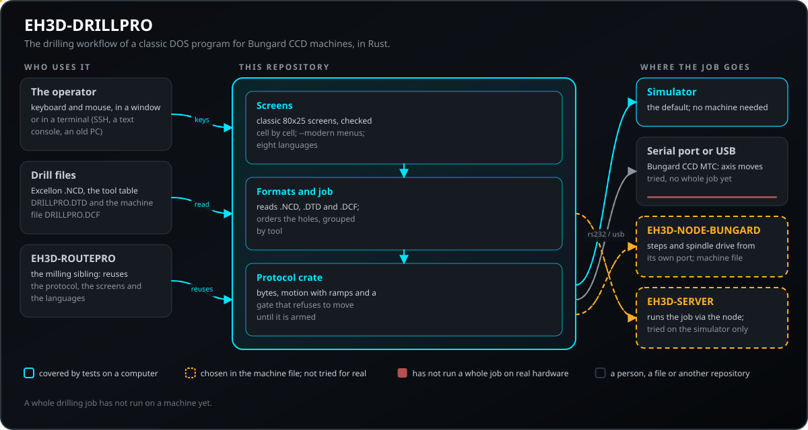
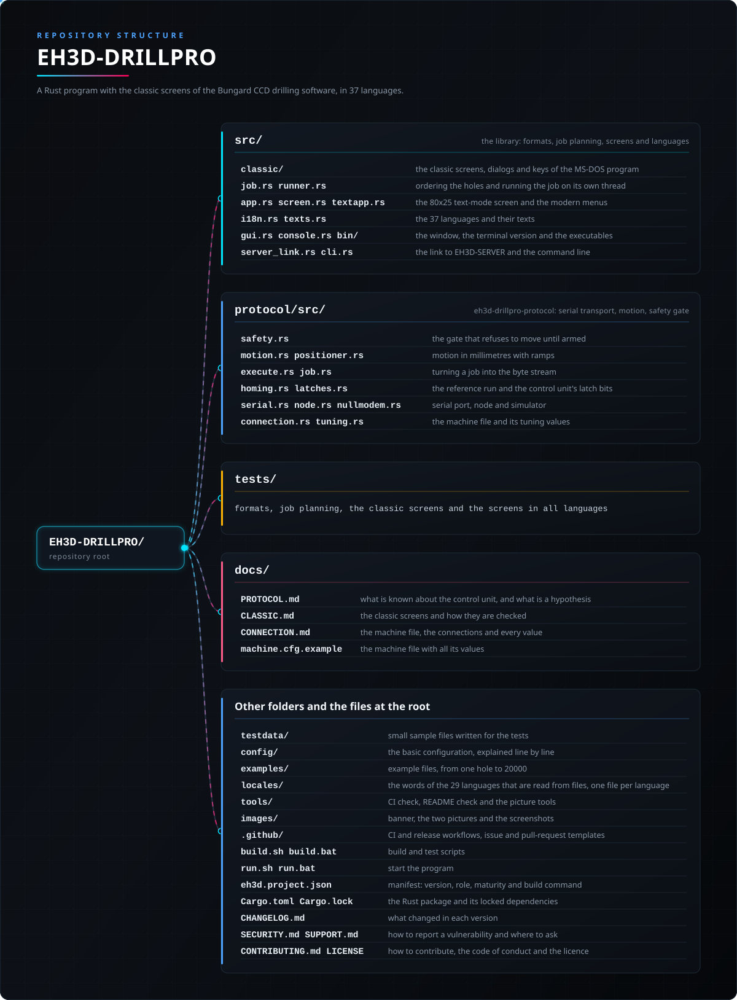

<p align="center">
  
</p>

# 🔩 EH3D-DRILLPRO

<p align="center"><a href="README.md">🇺🇸 English</a> | 🇪🇸 <b>Español</b> | <a href="README_fra.md">🇫🇷 Français</a> | <a href="README_ita.md">🇮🇹 Italiano</a> | <a href="README_deu.md">🇩🇪 Deutsch</a> | <a href="README_zho.md">🇨🇳 中文</a> | <a href="README_jpn.md">🇯🇵 日本語</a> | <a href="README_por.md">🇵🇹 Português</a></p>

### Una reimplementación multiplataforma en Rust del flujo de taladrado del clásico software DOS para máquinas Bungard CCD, con una interfaz de modo texto parecida a la original en ocho idiomas

<p align="center">
  
  
  
  
  
</p>

---

**Comprobación de honestidad - lo que se ejecuta hoy:** un programa en Rust con interfaz de texto de 80x25 que lee ficheros de taladrado Excellon `.NCD`, la tabla de herramientas y la configuración de la máquina, ordena los agujeros, los muestra y ejecuta todo el trabajo **contra un simulador** (por defecto) o, cuando el fichero de la máquina lo indica, **en una máquina real** por el puerto serie del ordenador, un adaptador USB-serie o el EH3D-NODE-BUNGARD. 213 pruebas se ejecutan en un ordenador. En una Bungard CCD MTC real se han probado la referencia de los tres ejes (Z, X e Y hasta sus finales de carrera, con la señal de «los tres en home» de la unidad de control confirmada en directo) y los movimientos de cada eje; **un trabajo de taladrado completo todavía no se ha ejecutado en la máquina**, y los pasos por milímetro solo se han contrastado con la configuración del original. Por defecto se muestran las pantallas clásicas del programa MS-DOS, comprobadas celda a celda contra el original; `--modern` inicia la interfaz de menús. Se manejan con teclado y ratón, la ventana se puede maximizar (la pantalla escala de 640x400 a 1080p y más), los ficheros de configuración y de herramientas se editan y se guardan desde los diálogos, y el botón Info lista las máquinas Bungard CCD y CCD/2 (MTC soportadas, ATC todavía no). Una versión de consola (`drillpro-console`) dibuja las mismas pantallas en un terminal, con teclado y ratón y sin sistema de ventanas (SSH, consola de texto, un PC antiguo). Los paquetes de cada release incluyen la configuración básica, explicada línea a línea, y una carpeta `examples` desde un agujero hasta veinte mil. El cambiador de herramienta de los modelos ATC (cambio automático) funciona a partir de una grabación del original y no se ha probado en una máquina real.

---

> **Estado de seguridad (safety) y de seguridad informática:** este programa no es un sistema de seguridad. Con una conexión real (`connection` en el fichero de la máquina) **Iniciar mueve la máquina**: saca la herramienta, mantén una mano en el interruptor de la máquina y ten lista la tecla `Esc`, que detiene el trabajo al instante y apaga los drivers de los motores. Los finales de carrera los vigila la propia unidad de control de la máquina (para el eje en su tope por sí sola); este software no tiene parada de emergencia propia, y unos bytes de paso o velocidades erróneos pueden llevar la herramienta contra la pieza o la mesa o hacer que los motores pierdan pasos. La capa de protocolo se niega a mover nada hasta que se arma. El proyecto es independiente: no lo fabrica, respalda ni da soporte Bungard Elektronik, y los nombres de producto aparecen solo para indicar con qué formatos de fichero y máquinas debe funcionar.

## 📋 De un vistazo

| | |
|---|---|
| Versión | `0.0.4` |
| Madurez | Andamiaje |
| Pruebas | 213 |
| Pila tecnológica | Rust |
| En hardware real | Sí, en una Bungard CCD MTC: la referencia y los movimientos de cada eje; un trabajo completo todavía no se ha ejecutado. Sin fichero de máquina se ejecuta en el simulador |

**Ir a:** [Resumen](#-resumen) · [Arquitectura](#-arquitectura) · [Inicio rápido](#-inicio-rápido) · [Pruebas](#-pruebas) · [Estructura](#-estructura-del-repositorio) · [Relacionados](#-proyectos-relacionados)

## 🚦 Estado del proyecto

Cada línea es una parte de este repositorio y la luz dice hasta dónde llega hoy. Se escribe con lo que el repositorio puede demostrar (pruebas, compilaciones, ejecuciones), no con lo previsto.

🟢 Hecho y verificado · 🟡 Funciona, con límites conocidos · 🟠 Hecho a medias o sin verificar · 🔴 Sin hacer o sin funcionar

| Área | Estado | Qué significa aquí |
|---|---|---|
| Software | 🟡 | Un programa en Rust con pantalla de texto de 80x25 lee el fichero de taladros, la tabla de herramientas y el fichero de la máquina, ordena los agujeros y ejecuta el trabajo entero contra un simulador, o en una máquina real si el fichero de la máquina lo indica. |
| Pruebas | 🟢 | Pasan 213 pruebas (`cargo test --workspace`): los formatos, la planificación del trabajo, el protocolo en el simulador y las pantallas en los ocho idiomas. |
| Lectores de ficheros | 🟡 | Se leen el fichero de taladros `.NCD`, la tabla de herramientas `DRILLPRO.DTD` y el fichero de la máquina `DRILLPRO.DCF`; solo con pequeños ficheros de muestra escritos para las pruebas, no con ficheros de placas reales. |
| Protocolo de la máquina | 🟠 | El protocolo de bytes de la unidad de control se reconstruyó por ingeniería inversa y `docs/PROTOCOL.md` aún lista partes que son hipótesis; la capa de protocolo se niega a mover nada hasta que se arma. |
| Interfaz | 🟡 | La pantalla de texto, los menús, el diálogo de ficheros y la vista vectorial de los agujeros hablan los ocho idiomas (probado); el chino y el japonés necesitan una fuente CJK en el sistema. |
| Hardware real | 🟠 | En una Bungard CCD MTC se han probado la marcha de referencia de los tres ejes y los movimientos de cada eje; no se ha ejecutado un trabajo de taladrado completo, los pasos por milímetro solo se han cotejado con la configuración del original y las salidas del husillo y del aspirador no se han probado. |
| Seguridad de uso | 🟡 | `Esc` detiene el trabajo en una fracción de segundo y apaga los drivers de los motores, y la propia unidad de control de la máquina vigila los finales de carrera; el software no tiene parada de emergencia propia. |
| Conexión con el servidor | 🟠 | Con `connection = server` el programa envía el trabajo a EH3D-SERVER y sigue su avance; este camino solo se ha ejercitado contra el simulador. |
| Paquetes listos para usar | 🟡 | La primera versión publicada lleva paquetes para Windows, Linux y macOS (Apple silicon e Intel), cada uno con su SHA-256, generados por el flujo de publicación. |
| Documentación | 🟢 | README en ocho idiomas, las notas del protocolo con lo que aún es hipótesis y la guía del fichero de la máquina con cada valor de ajuste. |

## 🎯 Resumen

* Los **lectores de ficheros**: ficheros de taladrado Excellon `.NCD` (con o sin la cabecera `M48`, coordenadas modales, unidades imperiales de 1 mil), la tabla de herramientas `DRILLPRO.DTD` y la configuración de la máquina `DRILLPRO.DCF`.
* El **planificador del trabajo**: ordena los agujeros (como en el fichero, primero X, primero Y o camino más corto) y los mantiene agrupados por herramienta.
* La **interfaz**: una pantalla de modo texto de 80x25 con colores CGA, menús, un diálogo de ficheros y una vista vectorial de los agujeros, mostrada en una ventana. Habla inglés, español, italiano, alemán, francés, portugués, chino y japonés: elige el idioma en el menú o arranca con `--lang`.
* El **protocolo de la máquina** (`protocol/`, crate `eh3d-drillpro-protocol`): una biblioteca sin interfaz: transporte de bytes (puerto serie o simulador), planificación de movimiento en milímetros con rampas de aceleración y una compuerta de seguridad que rechaza el movimiento hasta que se arma.
* El **simulador**: el trabajo completo se ejecuta hasta el final sin hardware; las pruebas lo usan.
* Las **máquinas**: las que llevan una central por puerto serie que usaba el software de MS-DOS 4.6: Bungard CCD MTC y CCD/2 MTC (cambio de herramienta manual; la CCD/2 tiene la mesa más pequeña de 325 x 270 mm). El tamaño de la mesa y demás constantes salen del fichero de configuración de la máquina. Solo se ha probado en una CCD MTC, y las salidas del taladro (husillo) y de la activación de la aspiradora todavía no se han probado. Los dos modelos ATC (CCD ATC y CCD/2 ATC, cambio automático) tendrán aplicaciones aparte, hechas con lo que permita la ingeniería inversa. Los modelos XL y las máquinas posteriores llevan unidad de control y software modernos propios y no están cubiertos.
* El **fichero de la máquina** (`machine.cfg`, compartido por DRILLPRO y ROUTEPRO): cómo llega el trabajo a la máquina (`demo` simulador, `rs232` el puerto serie del propio ordenador, `usb` un adaptador USB-serie o `node` el EH3D-NODE-BUNGARD por la red) y, un valor por línea, todo lo afinado en una máquina real: velocidades y rampas de búsqueda, el salto de calibración, los límites de los motores.
* La **referencia**: Z sube hasta su final de carrera, luego X e Y, y después un salto de calibración suave. La unidad de control indica «los tres ejes en home» por la línea RI, que el programa vigila; con la máquina aparcada se salta las búsquedas, separa X e Y 10 mm de sus finales de carrera y los busca de nuevo, así los ve llegar en directo.
* **Movimiento estable**: los movimientos salen como un único flujo continuo cuyas posiciones de byte llevan el tiempo (un adaptador USB entrega los bytes a ráfagas si no), Z se mueve byte a byte, y `Esc` cancela un trabajo en una fracción de segundo y apaga los drivers de los motores.
* El **husillo**: por defecto el de la propia central (sus bits de latch, hasta 60000 rpm); con `spindle = node` en el fichero de la máquina el trabajo se lo pide al EH3D-NODE-BUNGARD (un variador de frecuencia en las salidas del nodo, cualquier velocidad hasta el máximo del nodo, parado en cualquier parada). Con un nodo los programas leen además los LED de la máquina, así cada eje que llega a home se ve en directo sin leer la línea de home en mitad del flujo.
* La **conexión al servidor** (`connection = server` en el fichero de la máquina, con `server_address`, `server_token` y `server_machine`): en vez de manejar la máquina él mismo, el programa envía el trabajo al [EH3D-SERVER](https://github.com/JuanenRac/EH3D-SERVER), que lo planifica con las constantes de la máquina, lo ejecuta a través del nodo de la máquina y le cuenta al programa cómo va; el programa muestra el avance y responde a los diálogos como siempre, `Esc` detiene el trabajo en el servidor, y cerrar el programa no lo detiene.
* Los **archivos de trabajo, la ventana Offset y la simulación**: un trabajo puede ir empaquetado en un archivo ZIP (la ventana Select File entra en él y `drillpro JOB.ZIP` carga su primer fichero de taladrado); la flecha junto al nombre del fichero lista los patrones `*.NCD`, `*.ZIP` y `*.*`; los botones Load de las ventanas de herramientas y de configuración eligen el fichero que se carga; en una máquina real la ventana Offset hace el home, sigue cada movimiento de la ventana y vuelve a hacer el home; y el trabajo simulado tarda lo que tardaría la máquina.

## 🧩 Papel en EH3D

EH3D-DRILLPRO es un programa independiente de la familia EH3D para máquinas cuya unidad de control necesita que el PC genere cada paso de motor. EH3D-ROUTEPRO, su hermano de fresado, reutiliza su protocolo, su pantalla y su soporte de idiomas. Para los trabajos empaquetados en archivos ZIP usa un crate de EH3D-COMMON (`eh3d-archive`), que tiene que estar a su lado para compilar; el lector Excellon de EH3D-CORE-LIBS podría sustituir al suyo más adelante. Los ficheros de la máquina (el de taladrado, el HP-GL, las tablas de herramientas y la configuración de la máquina) vienen del crate `eh3d-bungard-formats` de EH3D-COMMON, que también tiene que estar a su lado.

## 🏛️ Arquitectura

<p align="center">
  
</p>

Cómo encajan las partes de este repositorio: quién lo usa, qué contiene y de qué depende. La imagen se dibuja desde `docs/architecture.json` y se comprueba contra el código.

## 🚀 Inicio rápido

Necesitas una cadena de herramientas de Rust estable.

```bash
cargo build --release --features gui
cargo test --workspace
cargo clippy --workspace --all-targets -- -D warnings
cargo fmt --all --check
python -I tools/ci_validate.py
```

Ejecútalo con `run.bat` (Windows) o `./run.sh` (Linux y macOS); ambos compilan antes el programa si hace falta: `run.bat [FICHERO.NCD] [--lang en|es|it|de|fr|pt|zh|ja] [--data DIR] [--dump]`. `--data` es la carpeta con `DRILLPRO.DTD` y `DRILLPRO.DCF` (por defecto: `testdata/`) y `--dump` imprime la pantalla como texto plano. Teclas: `Alt` más la letra resaltada abre un menú, las flechas mueven, `Enter` acepta, `Esc` vuelve; también se puede pulsar la barra de menús. El chino y el japonés necesitan una fuente CJK entre las del sistema. `--connection FILE` indica otro fichero de máquina distinto del predeterminado (`%APPDATA%\EH3D\machine.cfg` en Windows, `~/.config/eh3d/machine.cfg` en el resto); sin fichero de máquina el programa se ejecuta en el simulador. `--modern` inicia la interfaz de menús en lugar de las pantallas clásicas.

## 🧪 Pruebas

La suite tiene 213 pruebas (`cargo test --workspace`). Comprueban los formatos de fichero (el fichero de taladros, la tabla de herramientas y el fichero de la máquina, y su escritura de vuelta), la planificación del trabajo, el protocolo en el simulador (bytes, movimiento, la marcha de referencia, los bits de enclavamiento, el enlace con el nodo y la compuerta de seguridad que se niega a mover hasta que se arma), las pantallas clásicas celda a celda y las pantallas en los ocho idiomas. La CI también ejecuta `cargo fmt --check` y `cargo clippy` con las advertencias como errores, y `python -I tools/ci_validate.py` comprueba el manifiesto, las versiones, el registro de cambios y los ocho README.

## 🏗️ Compilación y publicación

La versión vive en `Cargo.toml` y en `eh3d.project.json`, y cada versión tiene su entrada en [CHANGELOG.md](CHANGELOG.md). Las versiones se publican en GitHub.

**Paquetes ya compilados:** cada versión publicada lleva un paquete para Windows (zip), Linux (tar.gz) y macOS (Apple silicon e Intel, tar.gz) con el programa, la licencia y este README, cada uno con su SHA-256 al lado. Los construye el workflow `Release binaries` de este repositorio. Descarga uno desde la página de Releases; en Linux la ventana necesita X11 o Wayland.

## 📂 Estructura del repositorio

<p align="center">
  
</p>

<details>
<summary>Versión en texto del árbol</summary>

```text
EH3D-DRILLPRO/
├── src/
│   ├── classic/                                 las pantallas, diálogos y teclas clásicos del programa de MS-DOS
│   ├── job.rs runner.rs                         ordenar los taladros y ejecutar el trabajo en su propio hilo
│   ├── app.rs screen.rs textapp.rs              la pantalla de texto de 80x25 y los menús modernos
│   ├── i18n.rs texts.rs                         los ocho idiomas y sus textos
│   ├── gui.rs console.rs bin/                   la ventana, la versión de terminal y los ejecutables
│   └── server_link.rs cli.rs                    el enlace con EH3D-SERVER y la línea de órdenes
├── protocol/src/
│   ├── safety.rs                                la compuerta que impide mover hasta armar
│   ├── motion.rs positioner.rs                  movimiento en milímetros con rampas
│   ├── execute.rs job.rs                        convertir un trabajo en el flujo de bytes
│   ├── homing.rs latches.rs                     la marcha de referencia y los bits de enclavamiento
│   ├── serial.rs node.rs nullmodem.rs           puerto serie, nodo y simulador
│   └── connection.rs tuning.rs                  el archivo de la máquina y sus valores de ajuste
├── tests/                                       formatos, planificación, pantallas clásicas y pantallas en todos los idiomas
├── docs/                                        las notas del protocolo, las pantallas clásicas, la guía de conexión y el archivo de la máquina con todos sus valores
├── testdata/                                    pequeños archivos de muestra escritos para las pruebas
├── config/                                      la configuración básica, explicada línea a línea
├── examples/                                    ejemplos, de un agujero a 20000
├── tools/                                       comprobación de CI, del README y las herramientas de imágenes
├── images/                                      banner y las imágenes de Arquitectura y Estructura del repositorio
├── .github/                                     flujos de CI y de publicación, plantillas de issues y pull requests
├── build.sh build.bat                           scripts de compilación y pruebas
├── run.sh run.bat                               arrancan el programa
├── eh3d.project.json                            manifiesto: versión, rol, madurez y comando de compilación
├── Cargo.toml Cargo.lock                        el paquete de Rust y sus dependencias fijadas
├── CHANGELOG.md                                 qué cambió en cada versión
├── SECURITY.md SUPPORT.md                       cómo informar de una vulnerabilidad y dónde preguntar
└── CONTRIBUTING.md CODE_OF_CONDUCT.md LICENSE   cómo contribuir, el código de conducta y la licencia
```

</details>

## 🗺️ Hoja de ruta y límites conocidos

**Límites conocidos hoy**

* Todavía no ha corrido un trabajo de taladrado completo en una máquina real: solo se han probado, en una Bungard CCD MTC, la marcha de referencia de los tres ejes y los movimientos de cada eje; los pasos por milímetro solo están comprobados contra la configuración del original y las salidas del husillo y del aspirador no se han probado.
* `docs/PROTOCOL.md` todavía lista partes del protocolo que son hipótesis; la capa de protocolo se niega a mover nada hasta que se arma.
* Los lectores de ficheros solo se han probado con pequeños ficheros de muestra escritos para las pruebas, no con ficheros de placas reales.
* La conexión con el servidor (`connection = server`) solo se ha ejercitado contra el simulador.
* Solo se admiten los modelos MTC; los modelos ATC todavía no y los modelos XL no están cubiertos. El chino y el japonés necesitan una fuente CJK entre las del sistema.

**Siguiente**

* Ejecutar un trabajo de taladrado completo en la máquina y confirmar los pasos por milímetro, el husillo y las salidas del aspirador.
* Probar los lectores de ficheros con ficheros de placas reales.
* Aplicaciones aparte para los modelos ATC, construidas con lo que permita la ingeniería inversa.
* Sustituir su propio lector de Excellon por el de [EH3D-CORE-LIBS](https://github.com/JuanenRac/EH3D-CORE-LIBS) cuando esté listo.

## 🌍 Idiomas

El README y los textos existen en inglés, español, francés, italiano, alemán, chino, japonés y portugués de Portugal.

## 🔗 Proyectos relacionados

* [EH3D-ROUTEPRO](https://github.com/JuanenRac/EH3D-ROUTEPRO): el hermano de fresado; usa el protocolo, la pantalla y los idiomas de este proyecto
* [EH3D-CORE-LIBS](https://github.com/JuanenRac/EH3D-CORE-LIBS): los lectores Excellon y de G-code compartidos de la suite
* [EH3D-COMMON](https://github.com/JuanenRac/EH3D-COMMON): el contenedor de proyecto y los tipos de telemetría de máquina de la suite
* [EH3D-NODE-BUNGARD](https://github.com/JuanenRac/EH3D-NODE-BUNGARD): un nodo ESP32-S3 (Ethernet o Wi-Fi) que va en la caja de la máquina, saca los pasos por su propio puerto serie con la temporización que un adaptador USB no puede mantener, lee los LED de la máquina y maneja el variador del husillo; tiene su propio panel web
* [EH3D-SERVER](https://github.com/JuanenRac/EH3D-SERVER): el centro de la familia EH3D: recibe los trabajos de este programa (`connection = server`) y de los demás clientes, y los ejecuta en la máquina a través de su nodo

## 📚 Documentación

* [Notas del protocolo](docs/PROTOCOL.md): lo que se sabe de cómo se maneja la unidad de control y lo que sigue siendo una hipótesis.
* [Conexión y ajuste](docs/CONNECTION.md): el fichero de la máquina, las tres conexiones y cada valor
* [Las pantallas clásicas](docs/CLASSIC.md): cómo se reproducen y se comprueban las pantallas del programa de MS-DOS
* [Registro de cambios](CHANGELOG.md)

## 🤝 Contribuir y comunidad

* Antes de una pull request ejecuta `cargo fmt --all --check`, `cargo clippy --workspace --all-targets -- -D warnings`, `cargo test --workspace` y `python -I tools/ci_validate.py`: todo debe pasar. Consulta [CONTRIBUTING.md](CONTRIBUTING.md) y el [código de conducta](CODE_OF_CONDUCT.md).
* El README existe en ocho idiomas: un cambio en el texto se hace en los ocho archivos, y las dos imágenes se dibujan a partir de `docs/architecture.json` y `docs/structure.json` con `tools/make_architecture.py` y `tools/make_structure.py`.
* No describas como funcionando en una máquina lo que solo se ha probado en el simulador.
* Informa de una vulnerabilidad en privado: [SECURITY.md](SECURITY.md). Preguntas, ideas e informes: electrohobby3d@gmail.com ([SUPPORT.md](SUPPORT.md)).

## 👤 AUTOR

**JuanenRac (Electro Hobby 3D)** · electrohobby3d@gmail.com

## 📜 LICENCIA

Software: GPL-3.0-or-later. Véase [LICENSE](LICENSE). Los diseños de hardware de la suite usan CERN OHL-S.
